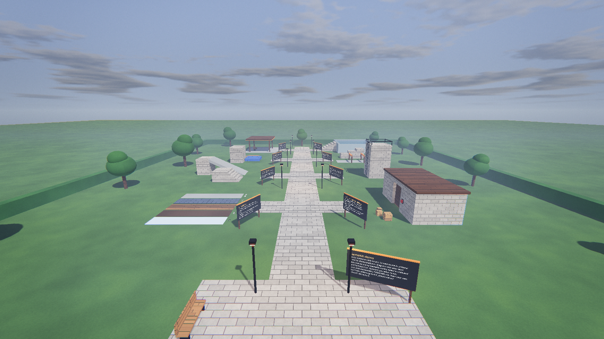
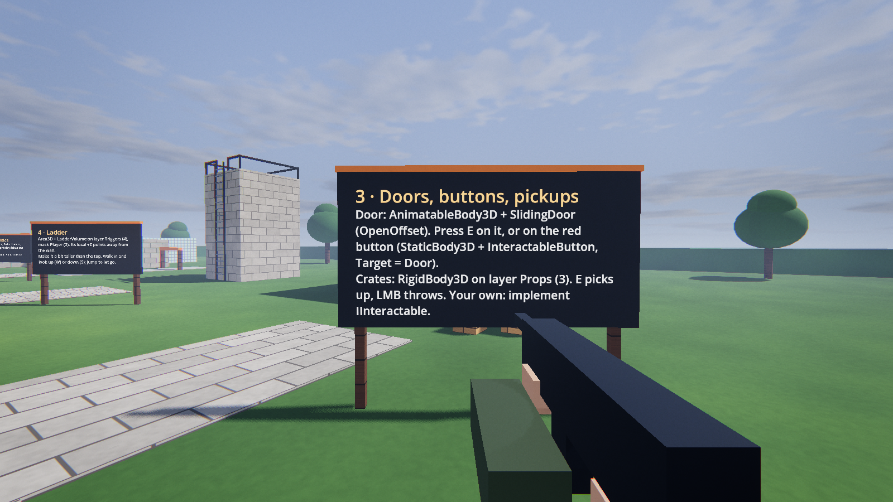
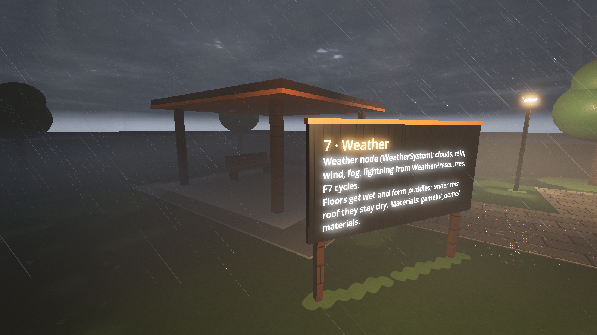

# GameKit Demo (GDScript)

A stand-alone Godot 4 **GDScript** project with a playable showcase of every GameKit module. You can
walk through it, read the signs, and copy any part into your own game. No .NET, no build step.

This is the GDScript port of [GameKitDemoCSharp](https://github.com/Diginaat/GameKitDemoCSharp): the
same map, scenes, materials and shaders, with every script rewritten in GDScript (snake_case names,
signals instead of C# events, duck-typed methods instead of C# interfaces).



| | |
| --- | --- |
|  |  |
|  | |

## Run it

1. Download the engine editor from the
   [latest Godot NVIDIA + PhysX release](https://github.com/Diginaat/godot/releases/latest). This demo
   was made and tested with the mono editor of
   [v0.7.3](https://github.com/Diginaat/godot/releases/tag/godot4.8-dev-nvidia-rt-dlss-physx-v0.7.3);
   a GDScript project does not need the C# features, so the standard editor should work too (not
   tested). The water
   module needs this engine's PhysX build. Stock Godot will not work.
2. Unzip it, start the editor, and import this folder (`project.godot`).
3. Press **F5**. The main scene is `addons/gamekit_demo/scenes/gamekit_demo.tscn`.

For exported games, install the matching export templates from the same release
(Editor > Manage Export Templates > Install from File).

From a terminal, with the editor unzipped next to this folder:

```
<path-to-editor>\godot.windows.editor.x86_64.mono.exe --path .
```

## What is inside

- `addons/gamekit_*`: the GameKit modules, ported to GDScript from the C# `GameClient` project.
- `addons/gamekit_demo`: the demo map, one scene per feature station, ready-made materials and the
  demo HUD. See [its README](addons/gamekit_demo/README.md) to use and change it.

## Add it to your project

See [addons/gamekit_demo/README.md](addons/gamekit_demo/README.md#use-it-in-your-project). In short:
copy `addons/gamekit_*`, merge four `project.godot` sections, and open the demo scene.

## Keeping the modules up to date

The modules here are a GDScript port of the C# modules in `GameClient` and
[GameKitDemoCSharp](https://github.com/Diginaat/GameKitDemoCSharp). Changes on the C# side have to be
ported by hand; the scenes and resources are shared, with property names in snake_case here.

## Credits

- **Diginaat**: GameKit modules, this demo project and its GDScript port.
- **Diginaat**: the [Godot NVIDIA + PhysX engine](https://github.com/Diginaat/godot) this project runs on.
- **Diginaat and DevKine**: EpicCameraX, which `gamekit_lens` is ported from (MIT, see
  `addons/gamekit_lens/LICENSE-EpicCameraX.txt`).
- **Godot Engine contributors**: [Godot Engine](https://godotengine.org) (MIT).
- **uno1982**: the [PhysX 5 module for Godot](https://github.com/uno1982/godot/tree/feature/physx5-module)
  (`feature/physx5-module`), which brings PhysX into the engine build.
- **NVIDIA**: PhysX, used by the engine build for physics and water.
- **Valve**: the player's acceleration and friction are modelled on Source SDK 2013 `gamemovement.cpp`.
- **Claude Code** (Anthropic's AI assistant): co-author of the code and docs, as noted in the commit messages.
